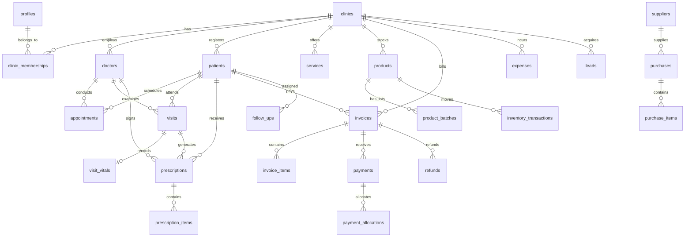

# Database Schema Documentation: Clinic POS + CRM SaaS

## Overview
The database is built on PostgreSQL via Supabase, with full multi-tenant isolation via `clinic_id`, Row Level Security (RLS) enforcement, and an atomic checkout RPC (`execute_pos_sale`) with row-level concurrency locking.

---

## ER Diagram (Core Relationships)

---

## 30+ Database Tables Summary

1. `clinics`: Multi-tenant root organization entity with currency, timezone, invoice prefix, and module flags.
2. `profiles`: User profile data connected with `auth.users(id)`.
3. `clinic_memberships`: Role-based membership (`super_admin`, `admin`, `doctor`, `receptionist`, `cashier`, `pharmacist`, `accountant`).
4. `doctors`: Medical doctor registry with specialties, room numbers, and consultation fee tariffs.
5. `patients`: Complete patient CRM files, unique MRN (`PAT-YYYY-XXXX`), demographics, and medical tags.
6. `appointments`: Queue slots with status progression and doctor conflict prevention.
7. `visits`: Historical SOAP clinical consultation records (Chief Complaint, History, Assessment, Plan).
8. `visit_vitals`: Objective measurements (BP, Pulse, Temp, SpO2, Weight, Height, and computed BMI).
9. `prescriptions`: Signed e-prescriptions linked to consultation and doctor.
10. `prescription_items`: Multi-drug rows with dosage, frequency, course duration, and instructions.
11. `services`: Clinical services, lab tests, and procedures price list.
12. `product_categories`: Categorization for pharmacy drugs and clinical consumables.
13. `products`: Medical items, SKU, barcodes, purchase prices, selling prices, and min reorder levels.
14. `product_batches`: Batch lots with expiry dates and current stock quantities.
15. `suppliers`: Pharmaceutical distributors and medical supply vendor directory.
16. `purchases`: Supplier purchase orders (PO) and goods received notes (GRN).
17. `purchase_items`: Individual items in each purchase shipment.
18. `inventory_transactions`: Immutable log of every stock increment, sale deduction, or adjustment.
19. `invoices`: Commercial billing invoices (`INV-YYYY-XXXXXX`) with subtotals, tax, discounts, paid amount, and balance due.
20. `invoice_items`: Snapshot line items preserving historical billing prices.
21. `payments`: Individual tender records (Cash, Card, JazzCash, EasyPaisa, Bank Transfer) with transaction IDs.
22. `payment_allocations`: Mapping of split payments against invoice balances.
23. `refunds`: Controlled reimbursement vouchers with audit tracking.
24. `expenses`: Clinic operational expenditure vouchers with category breakdown.
25. `leads`: Inbound inquiries CRM pipeline with 1-click patient registration.
26. `follow_ups`: Care continuity schedule with direct WhatsApp integration.
27. `communications`: Audit log of SMS, WhatsApp, and phone touchpoints.
28. `notifications`: In-app operational alerts (low stock, check-ins, reminders).
29. `audit_logs`: Immutable security and financial audit trail.
30. `clinic_settings`: Global clinic operational settings, hours, and modular toggles.

---

## Atomic POS Sale Function (`execute_pos_sale`)
Handles the complete transaction safely:
- Validates payload server-side (never trusts client totals)
- Checks `idempotency_key` to prevent double-charging
- Generates sequential invoice number `INV-YYYY-XXXXXX`
- Locks batches using `SELECT ... FOR UPDATE` (FEFO ordering)
- Decrements batch quantity & product overall stock
- Records `inventory_transactions` row
- Inserts `invoices` & `invoice_items`
- Inserts `payments` (supporting split tender)
- Logs to `audit_logs`
- If anything fails, rolls back completely.
